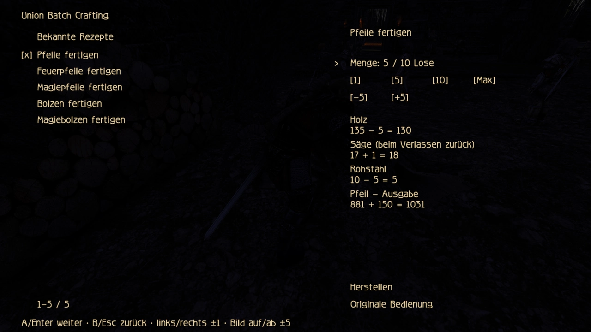

<a id="overview"></a>

# Union Batch Crafting

[English](README.md) · [Deutsch](README.de.md)

Ein Union-Plugin für Gothic II: Die Nacht des Raben mit der Mod Marcello L’Hiver DE 2.0.4. Wähle an einer Werkstation ein gelerntes Rezept und eine Menge, prüfe Material und Vorschau und stelle alles auf einmal her, statt den Originaldialog für jedes Stück zu wiederholen.



Ein Los ergibt 30 Pfeile. Beim Verlassen der Station wandert die Säge zurück ins Inventar.

<a id="features"></a>

## Funktionen

- Ein Mengenmenü für 98 Rezeptprofile an neun Stationen: Herd, Alchemietisch, Lederbank, Säge, Esse, Amboss, Bogenbank, Kühlbecken und Schleifstein.
- Vorgaben für 1, 5, 10 und Maximum sowie jede freie Menge bis zur Materialgrenze.
- Benötigtes Material, aktueller Vorrat und eine Vorschau des Ergebnisses für die gewählte Menge.
- Gesperrte Rezepte nennen den Grund, etwa „[ausgerüstet]“, „[Zutaten fehlen]“ oder „[Platz fehlt]“.
- Ein Auftrag läuft nur, wenn Material und Stationsbedingungen zum geprüften Rezept passen. Sonst bleibt die Originalauswahl des Spiels verfügbar.
- Deutsche und englische Menüs, erkannt am Spieltext oder in `Gothic.INI` festgelegt. Weitere Sprachen lassen sich im Quellcode als Texttabelle ergänzen.
- Bedienung per Tastatur und mit der vorhandenen Controllerbelegung des Spiels.

[Stationsanleitung](docs/STATIONEN.md) · [Bedienung](docs/STATIONEN.md#controls) · [Sprache ergänzen](docs/STATIONEN.md#adding-a-language)

<a id="status"></a>

## Stand

Dies ist eine frühe Version. Im Spiel geprüft sind ausgewählte Rezepte und Mengen an jeder Station, aufgeführt in der [Stationsanleitung](docs/STATIONEN.md#coverage). Die übrigen Profile warten noch auf einen Auftrag im Spiel. Mit einem echten Controller ist die Bedienung an den Stationen noch nicht getestet. Das Plugin prüft die Engine und die Skriptfunktionen, die jedes Rezept braucht. Passt etwas nicht, bleibt die Originalauswahl verfügbar. Eine abweichende Engine kann das ganze Plugin abschalten. [Getestet mit](TESTED-WITH.md) · [Changelog](CHANGELOG.md#deutsch)

<a id="install"></a>

## Installation

Lade `union-batch-crafting-player-<Version>.zip` unter [Releases](https://github.com/ne1800/union-batch-crafting/releases) herunter und kopiere `system/autorun/UnionBatchCraftingExtended.dll` in den Spielordner. Das Plugin bleibt aktiv, bis du die DLL entfernst oder in `system/Gothic.INI` `Enabled=0` setzt. [Installation, Einstellungen und Deinstallation](INSTALL.de.md)

<a id="build"></a>

## Aus dem Quellcode bauen

Unter Linux brauchst du Clang mit C++17-Unterstützung, CMake ab 3.21, Ninja, Python ab 3.10 und mise. Baue und prüfe den portablen Teil im Stammverzeichnis dieses Checkouts:

```sh
mise trust
mise run build:native
ctest --test-dir build/native --output-on-failure
mise run test:tools
```

Die Python-Tests prüfen beide Sprachfassungen und ihre Links. Die nativen Tests nutzen synthetische Testdaten und die Rezepttabelle. Die positiven Prüfungen gegen Original-EXE und Modarchiv benötigen eine passende lokale Spielinstallation und werden beim portablen Lauf übersprungen.

Für den Windows-Bau brauchst du zusätzlich clang-cl, LLD, llvm-rc, llvm-mt und das x86-SDK mit CRT. Wenn du Microsofts SDK-Lizenz akzeptierst, lädt der optionale erste Befehl die festgelegte xwin-Version und richtet das SDK unter `.tools/xwin` ein. Liegt es dort bereits vor, genügt der zweite Befehl.

```sh
mise run setup:windows-WRITES -- --apply
mise run build:windows
```

Das Plugin liegt unter `build/windows/player/UnionBatchCraftingExtended.dll`. Der Bau benötigt keine Spieldateien. Der eigene Code steht unter der [MIT-Lizenz](LICENSE). Für xwin gilt MIT/Apache-2.0. Für das SDK und die statisch in die Windows-DLL eingebundene Release-CRT gelten Microsofts Bedingungen.

Das Spieler-ZIP entsteht mit `mise run package:player-WRITES -- --apply`.

<a id="development"></a>

## Mitwirken

Fehler und Vorschläge bitte als GitHub-Issue melden. Codeänderungen als Pull Request gegen `main` einreichen. Ein Maintainer prüft jeden Pull Request.

Commit-Betreffzeilen und Titel von Pull Requests sind auf Englisch und folgen Conventional Commits, etwa `fix(ui): handle empty recipe lists`. Der Scope ist optional. Ein `!` vor dem Doppelpunkt kennzeichnet eine inkompatible Änderung.

`mise run lint:all` führt prek auf allen versionierten Dateien aus. prek installiert beim ersten Lauf alle Formatierer und Linter in fest gepinnten Versionen, darunter clang-format 23.1.5 und gersemi 0.29.2. Mit `mise run test:report-WRITES -- --apply` laufen die portablen Tests. Nach `mise x -- prek install` laufen die Prüfungen vor jedem Commit.

Die automatischen Tests starten das Spiel nicht. Wenn deine Änderung das Herstellen im Spiel betrifft, beschreibe im Pull Request, was du im Spiel und mit welchem Aufbau getestet hast. Den Referenzaufbau nennt [Getestet mit](TESTED-WITH.md).

<a id="ci"></a>

## Kontinuierliche Integration

GitHub Actions prüft jeden Pull Request und jeden Push nach `main` mit prek, den portablen Tests und einem Windows-x86-Build. Der Build muss die SHA-256-Werte von Spieler- und Test-DLL aus `tools/ci/dll.sha256` reproduzieren. Ändert dein Beitrag eine DLL, zeigt das Job-Log die neuen Werte. Trage sie im selben Pull Request in die Datei ein oder führe nach einem Windows-Build `mise run release:prepare-WRITES -- --pin-dlls --apply` aus.

Die Datei `VERSION` nennt die aktuelle Version. `mise run release:prepare-WRITES -- --version <x.y.z> --apply` setzt sie in den Anleitungen und legt Changelog-Platzhalter in beiden Sprachen an. Ein Pull Request, der `VERSION` ändert, muss außerdem die im Spiel getestete Spieler-DLL in [Getestet mit](TESTED-WITH.md) eintragen. Mergt der Maintainer ihn, setzt GitHub Actions den Versionstag und veröffentlicht das Release mit Spieler-ZIP, Changelog-Eintrag und SHA-256-Werten.

<a id="renovate"></a>

## Abhängigkeiten

Renovate schlägt Updates für gepinnte Werkzeuge und GitHub Actions als Pull Requests vor, montags vor 06:00 Uhr (Europe/Berlin) und nach 14 Tagen Wartezeit. Updates der Windows-Toolchain ändern die DLLs und warten im Dependency Dashboard auf Freigabe.

<a id="license"></a>

## Lizenz

Der eigene Code steht unter der [MIT-Lizenz](LICENSE). Die [Hinweise zu Drittkomponenten](THIRD-PARTY-NOTICES) betreffen die in die DLL gelinkte Microsoft-Laufzeit. Das Repository enthält keine Spieldateien, Originalskripte oder Spielstände.

Die Bildschirmfotos unter `docs/images/` zeigen Szenen aus Gothic II und der Mod Marcello L’Hiver. Diese Spielinhalte gehören ihren Rechteinhabern und fallen nicht unter die MIT-Lizenz.
